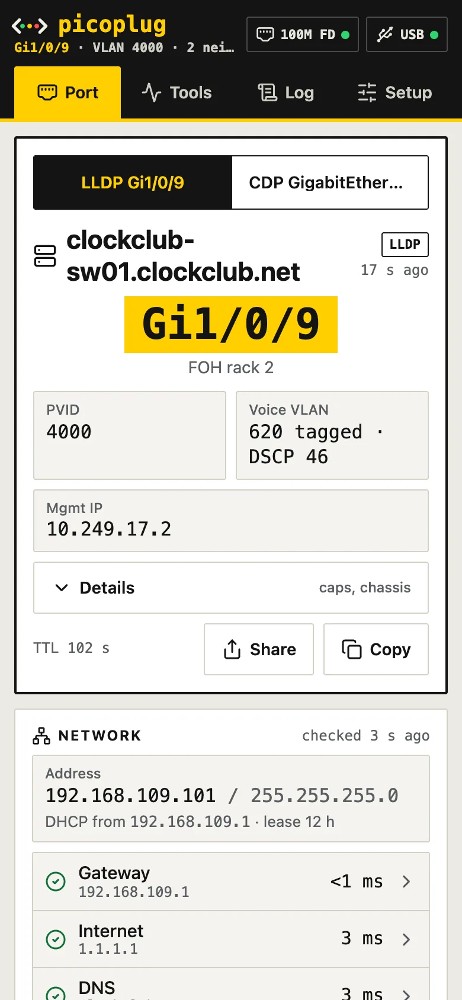
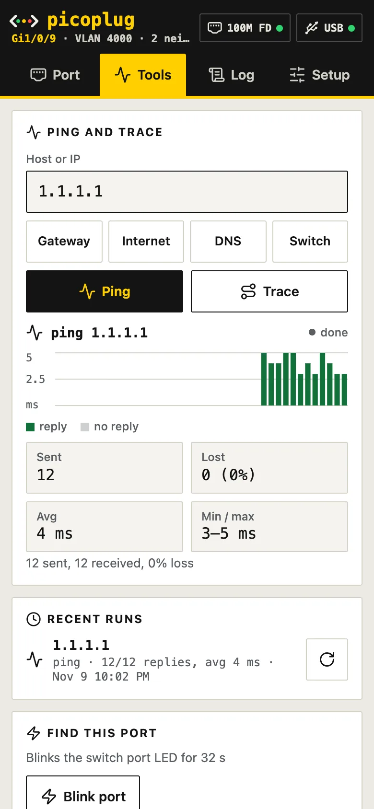
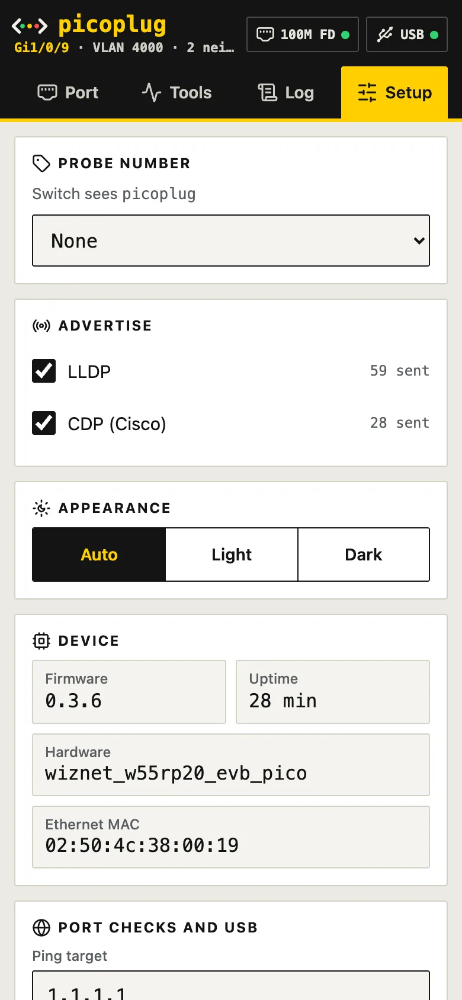
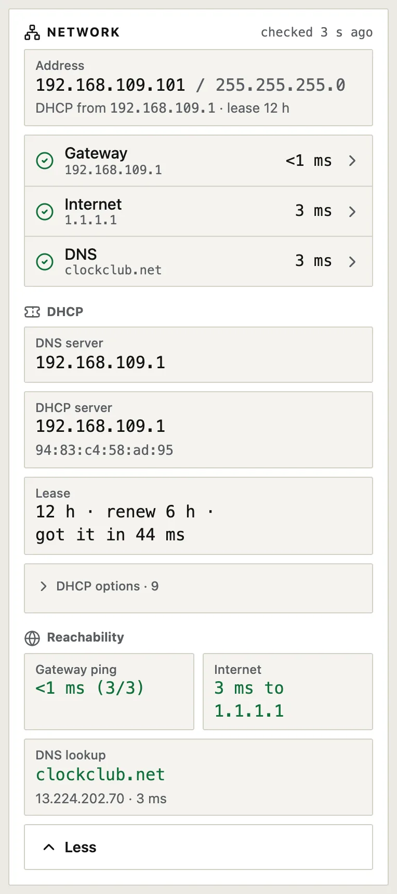
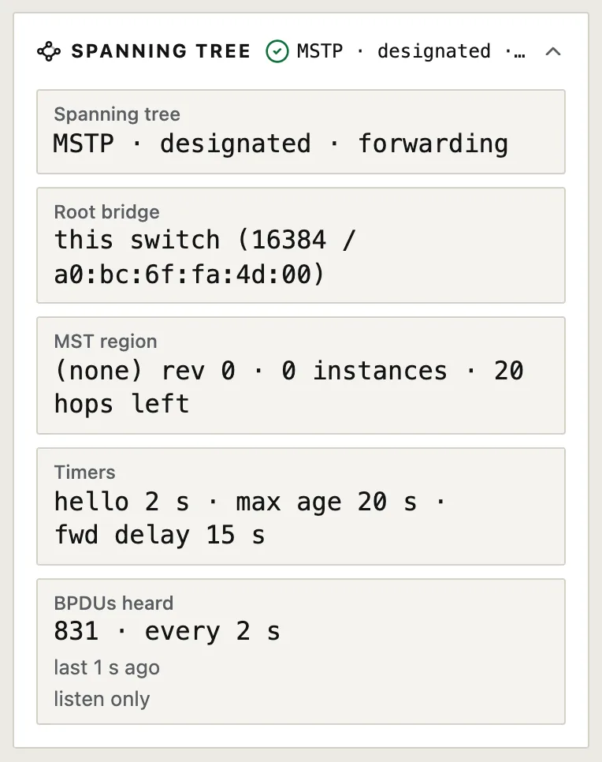
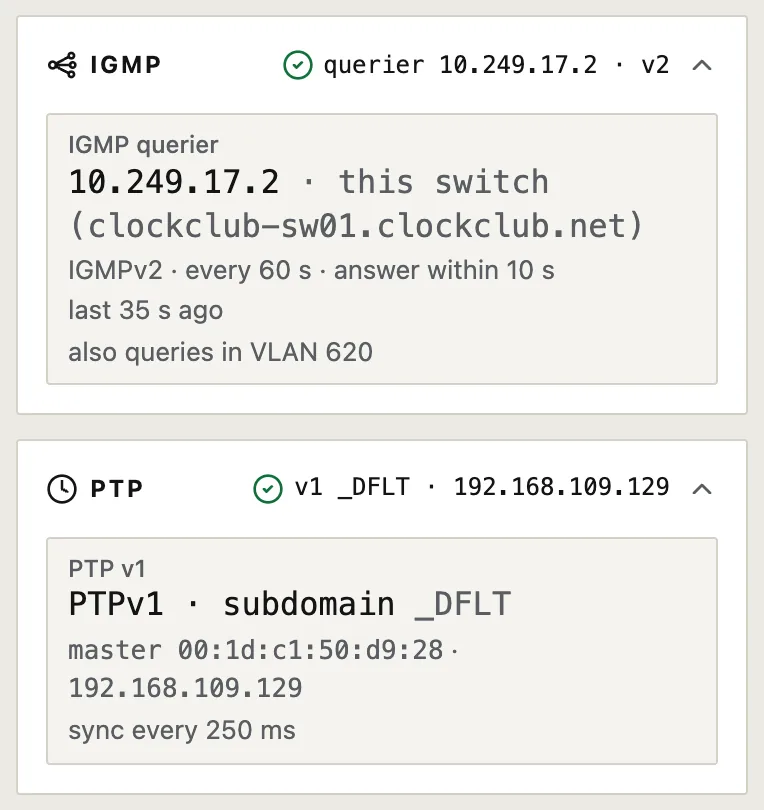
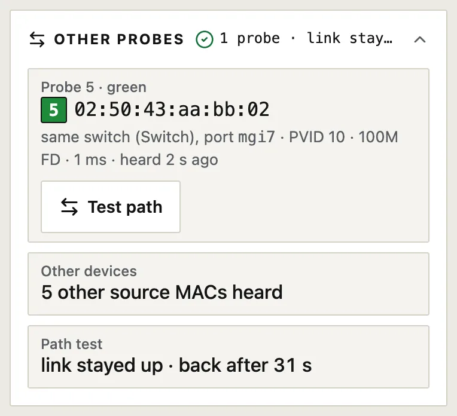

# picoplug - pocket switch-port tester

A WIZnet W55RP20-EVB-Pico (RP2040 + W5500, about $10) that plugs into a
switch port and tells you, on your phone, what that port is. No app, no
account, no extra hardware: the board appears over USB-C as a network
adapter and serves one web page at http://192.168.7.1/ (picoplug.local).

<p>
<picture><source media="(prefers-color-scheme: dark)" srcset="docs/img/port-dark.webp"></picture>
<picture><source media="(prefers-color-scheme: dark)" srcset="docs/img/tools-dark.webp"></picture>
<picture><source media="(prefers-color-scheme: dark)" srcset="docs/img/setup-dark.webp"></picture>
</p>

What the page answers:

* **Which switch and port am I on?** LLDP and CDP neighbor: switch name,
  port, port description, PVID, VLAN names, voice VLAN, management IP,
  PoE budget, chassis, capabilities, LAG state.
* **Does the port work?** DHCP lease with every option the server sent,
  gateway / internet / DNS checks, spanning-tree role, state and root
  bridge from the port's BPDUs, passive 802.1X detection.
* **Is the AV network behind it healthy?** IGMP querier (version, who it
  is), PIM multicast router, PTP v1 and v2 (domain, transport)
  masters and grandmaster, shown in their own card when the port carries
  any of it.
* **Tools:** ping with a live RTT plot, traceroute, and a port blinker
  that flaps the link so the switch LED shows you the port.
* **Two probes:** probes find each other on the wire (no IP needed), show
  which switch and port the other one is on and its PVID, and
  test whether the run between them is a direct cable or goes through a
  switch.
* **History** of every port visited, kept in the browser, exportable as CSV.
* **Share:** a Share button that links the port to the picoplug share
  page, which shows it to whoever opens the link, or copies it as text.
  The link can point at your own web form instead (a NOC request form, a
  ticket) with the switch, port and VLAN filled in.

<p>
<picture><source media="(prefers-color-scheme: dark)" srcset="docs/img/switch-dark.webp"></picture>
<picture><source media="(prefers-color-scheme: dark)" srcset="docs/img/network-dark.webp"></picture>
</p>
<p>
<picture><source media="(prefers-color-scheme: dark)" srcset="docs/img/protocols-dark.webp"></picture>
<picture><source media="(prefers-color-scheme: dark)" srcset="docs/img/av-dark.webp"></picture>
<picture><source media="(prefers-color-scheme: dark)" srcset="docs/img/probes-dark.webp"></picture>
</p>

The same page is served read-only on the port's own DHCP address, so the
tester can be left on a far port with USB power and read from a laptop on
the network. The page gets every change pushed over a WebSocket (`/ws`),
so it updates as the tester hears things. A raw NDJSON status stream is on
TCP :9000 (USB side) for scripts.

On Android, turn Wi-Fi off while using the tester: with Wi-Fi on, Android
sends the browser over Wi-Fi and the page at 192.168.7.1 can't be reached.

```
Switch --Ethernet--> W5500 (MACRAW) --SPI--> RP2040 --USB NCM--> phone / laptop browser
                                              lwIP + DHCP + HTTP :80 + NDJSON :9000
```

* `firmware/` - Pico SDK + TinyUSB + lwIP firmware (C)
* `firmware/web/` - the built-in page, a Svelte app built to one file and embedded at build time
* `firmware/test/` - host-side unit tests and a headless-Chrome smoke test of the page
* `docs/PROTOCOL.md` - JSON schema of `/status.json` and the :9000 stream, HTTP endpoints
* `THIRD_PARTY_LICENSES.md` - notices for the bundled Pico SDK, lwIP, TinyUSB, WIZnet ioLibrary, Svelte and Lucide icons

## Build

Needs CMake, Python 3, Node.js (the build compiles the page) and the Arm
GNU toolchain (14.x with newlib; the Homebrew `arm-none-eabi-gcc` lacks
newlib).

```
git clone <this repo> picoplug && cd picoplug
git submodule update --init firmware/lib/pico-sdk firmware/lib/ioLibrary_Driver
git -C firmware/lib/pico-sdk submodule update --init lib/tinyusb lib/lwip
cmake -S firmware -B build-w55rp20 -DPICO_BOARD=wiznet_w55rp20_evb_pico \
      -DPICO_TOOLCHAIN_PATH=/path/to/arm-gnu-toolchain
cmake --build build-w55rp20
```

Hold BOOTSEL while plugging in the board and copy
`build-w55rp20/picolldp.uf2` to the RPI-RP2 drive. A running board can
also be put into that mode by opening http://192.168.7.1/reboot?bootsel=1.
Host tests:
`cmake -S firmware/test -B build-test && cmake --build build-test && ctest --test-dir build-test`.
