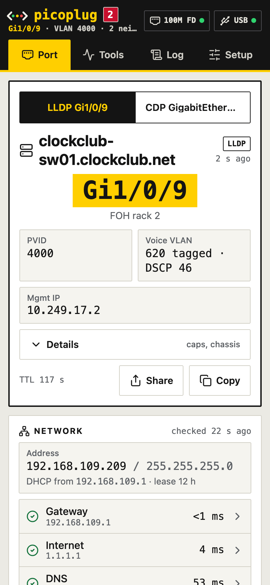
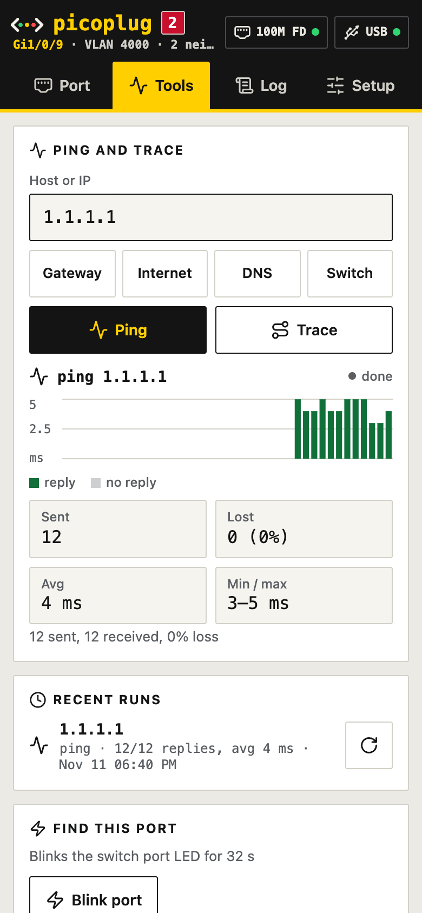
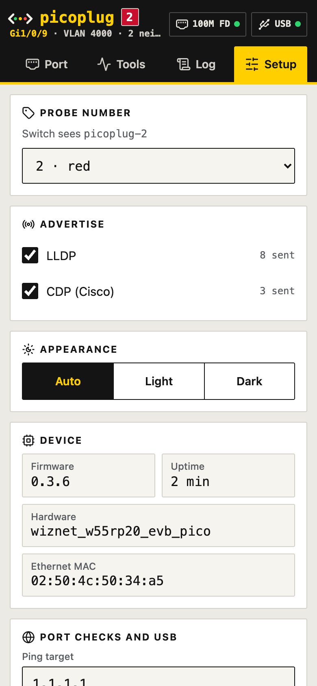
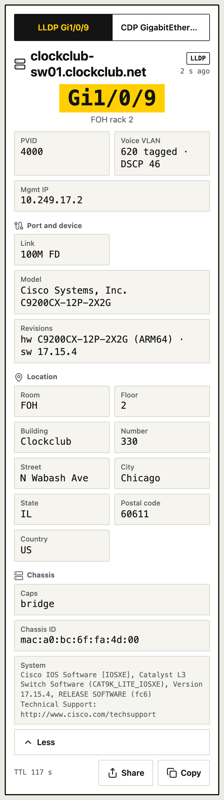
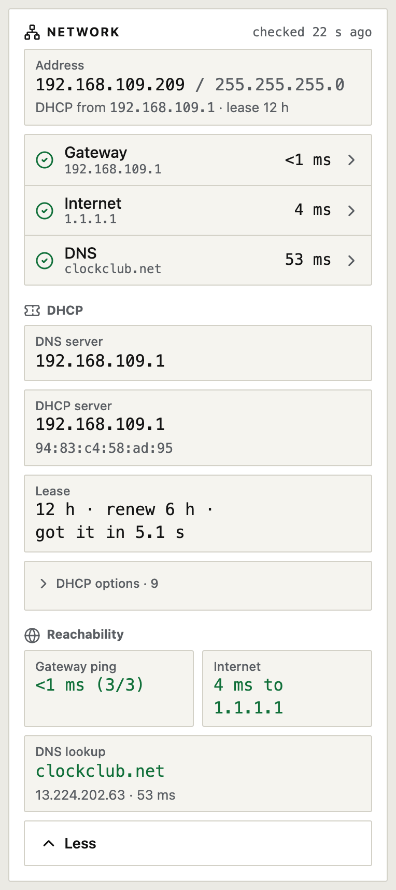
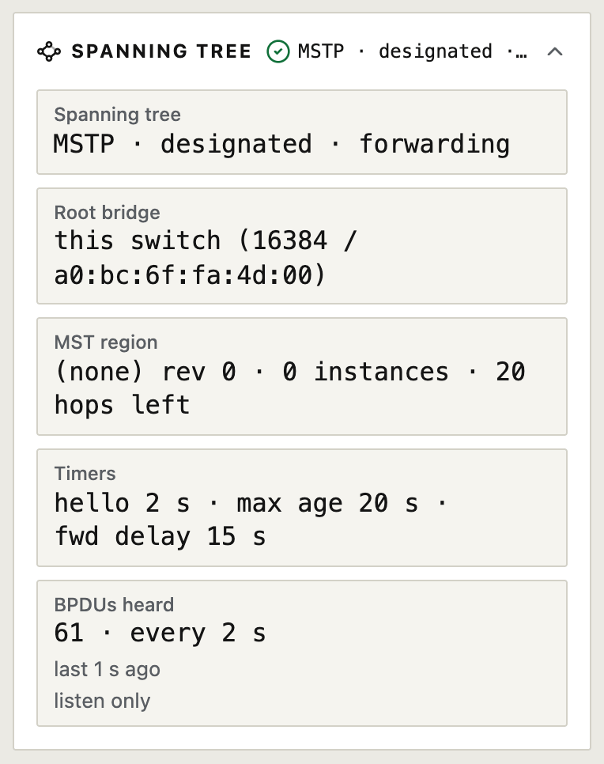
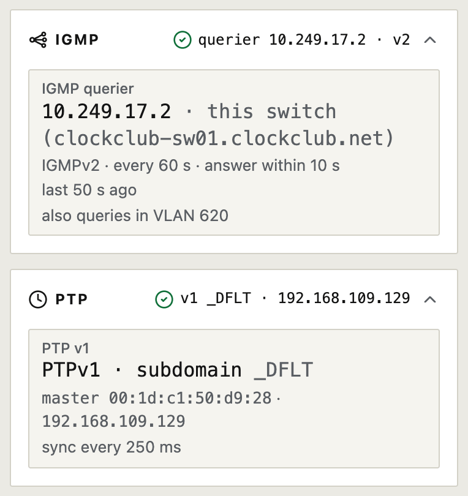
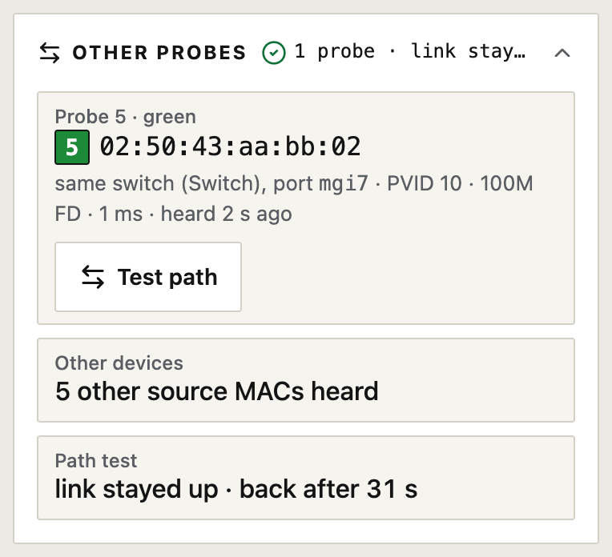

# picoplug

$12 Pocket network tool

Picoplug turns a $12 WIZnet development board into a pocket network tool. The picoplug shows up as a USB Ethernet adaptor and hosts an application with various network diagnostic tools.

<p>
<picture><source media="(prefers-color-scheme: dark)" srcset="docs/img/port-dark.png"></picture>
<picture><source media="(prefers-color-scheme: dark)" srcset="docs/img/tools-dark.png"></picture>
<picture><source media="(prefers-color-scheme: dark)" srcset="docs/img/setup-dark.png"></picture>
</p>

## Hardware

Picoplug runs on WIZnet's [W55RP20-EVB-Pico](https://wiznet.io/products/evaluation-boards/w55rp20-evb-pico) board. This  $12 development board is available through electronic component distributers like DigiKey and Mouser. The board hosts a [W55RP20](https://wiznet.io/products/mcu-chips/w55rp20), this SiP includes a RP2040 microcontroller and W5500 Ethernet controller into a tiny 8mm x 8mm package. Picoplug boots within seconds and is powered by the phone. Files for printing the case are included in the project.

## Make your own picoplug

1. **Purchase a W55RP20-EVB-Pico:** [DigiKey](https://www.digikey.com/en/products/detail/wiznet/W55RP20-EVB-PICO/24717058), [Mouser](https://www.mouser.com/en/ProductDetail/WIZnet/W55RP20-EVB-Pico?qs=IKkN%2F947nfCQ%252BaR4QuygXA%3D%3D)
2. **Download the firmware:** [latest release](https://github.com/karlcswanson/picoplug/releases/latest)
3. **Flash the firmware:** Hold down the BOOTSEL button when plugging the board into the computer. Once the `RPI-RP2` volume appears, drag on the `-w55rp20.uf2` firmware file.
4. **Print the case (optional):** [STL files and print settings](docs/ENCLOSURE.md)
5. **Plug it into your phone:** The picoplug is accessible at http://192.168.7.1 or http://picoplug.local. The IP address can be changed in the Settings tab. Android and iOS devices handle network routes slightly differently. For use on Android devices, Airplane mode may need to be enabled to access the picoplug.

## Features

<p>
<picture><source media="(prefers-color-scheme: dark)" srcset="docs/img/switch-dark.png"></picture>
<picture><source media="(prefers-color-scheme: dark)" srcset="docs/img/network-dark.png"></picture>
</p>

### LLDP & CDP
- Switch management info: MAC and IP
- Port-level info like VLANs and port descriptions
- Switch software versions and serial numbers

### Network
- DHCP
- DNS
- Internet
- Ping

### Spanning tree
- STP, RSTP or MSTP, with port role and state
- Root bridge priority and MAC
- MST region and revision
- Timer and BPDU intervals

### LAG
- LACP from the switch: forwarding or not
- Active or passive, key and port

### 802.1X
- Display when port asks for authentication
- Authenticator MAC and request frequency

### IGMP
- IGMP querier: address, version and interval

### PTP
- PTPv1 and PTPv2 masters
- Grandmaster, domain, or subdomain
- Transport and sync interval

<p>
<picture><source media="(prefers-color-scheme: dark)" srcset="docs/img/protocols-dark.png"></picture>
<picture><source media="(prefers-color-scheme: dark)" srcset="docs/img/av-dark.png"></picture>
</p>

### Picoplug remote
- Click to inspect remote picoplugs
- Testers discover each other via mDNS

<picture><source media="(prefers-color-scheme: dark)" srcset="docs/img/probes-dark.png"></picture>

### LLDP/CDP advertisement
- Discoverable via switch and other network tools

```
clockclub-sw01>sh lldp nei
Device ID     Local Intf
picoplug-2    Gi1/0/9
```

## Tools, Port Log, and Settings

### Tools
- Ping
- Traceroute
- Blink port

### Port Log
- Every port visited, kept in the phone's browser
- A note per port
- CSV export

### Settings
- Probe number
- LLDP and CDP advertising
- Light or dark
- Port-check targets, the USB address and the Share link

## From the network side

The picoplug webpage is served read-only and is available at `picoplug-N.local`. A remote tester with USB power can be accessed from across the network at its IP or picoplug-n.local.

## picoplug vs. testers that cost more than $12

| | LinkRunner 10G | Pockethernet 2 | netool.io | picoplug |
|---|:-:|:-:|:-:|:-:|
| **Price** | **$5,675** | **$275** | **$299** | **$12** |
| Costs $12 | - | - | - | ✓ |
| Gigabit | ✓ | ✓ | ✓ | - |
| Multi-gig/10G | ✓ | - | - | - |
| SFP+ transceiver support | ✓ | - | - | - |
| Wire map | ✓ | ✓ | - | - |
| Cable length and fault finding (TDR) | ✓ | ✓ | - | - |
| Tone generator for tracing cable | ✓ | ✓ | - | - |
| Test PoE | ✓ | ✓ | - | - |
| Built-in display | ✓ | - | - | - |
| Battery powered | ✓ | ✓ | ✓ | - |
| Report generation | ✓ | ✓ | - | - |
| Product support | ✓ | ✓ | ✓ | - |
| LLDP and CDP | ✓ | ✓ | ✓ | ✓ |
| DHCP | ✓ | ✓ | ✓ | ✓ |
| Ping | ✓ | ✓ | ✓ | ✓ |
| Blink remote switch port | ✓ | ✓ | ✓ | ✓ |

## How it works

The page gets every change pushed over a WebSocket (`/ws`), so it updates
as the tester hears things. A raw NDJSON status stream is on TCP :9000
(USB side) for scripts.

```
Switch --Ethernet--> W5500 (MACRAW) --SPI--> RP2040 --USB NCM--> phone / laptop browser
                                              lwIP + DHCP + HTTP :80 + NDJSON :9000
```

* `firmware/` - Pico SDK + TinyUSB + lwIP firmware (C)
* `firmware/web/` - the built-in page, a Svelte app built to one file and embedded at build time
* `firmware/test/` - host-side unit tests and a headless-Chrome smoke test of the page
* `docs/PROTOCOL.md` - JSON schema of `/status.json` and the :9000 stream, HTTP endpoints
* `THIRD_PARTY_LICENSES.md` - notices for the bundled Pico SDK, lwIP, TinyUSB, WIZnet ioLibrary, Svelte and Lucide icons
* `CLAUDE.md` - notes for working on the code (with or without an AI assistant)

## Build

Needs CMake, Python 3, Node.js (the build compiles the page) and the Arm
GNU toolchain (14.x with newlib; the Homebrew `arm-none-eabi-gcc` lacks
newlib).

```
git clone <this repo> picoplug && cd picoplug
git submodule update --init firmware/lib/pico-sdk firmware/lib/ioLibrary_Driver
git -C firmware/lib/pico-sdk submodule update --init lib/tinyusb lib/lwip
cmake -S firmware -B build-w55rp20 -DPICO_BOARD=wiznet_w55rp20_evb_pico \
      -DPICO_TOOLCHAIN_PATH=/path/to/arm-gnu-toolchain
cmake --build build-w55rp20
```

Hold BOOTSEL while plugging in the board and copy
`build-w55rp20/picolldp.uf2` to the RPI-RP2 drive. A running board can
also be put into that mode by opening http://192.168.7.1/reboot?bootsel=1.
Host tests:
`cmake -S firmware/test -B build-test && cmake --build build-test && ctest --test-dir build-test`.
