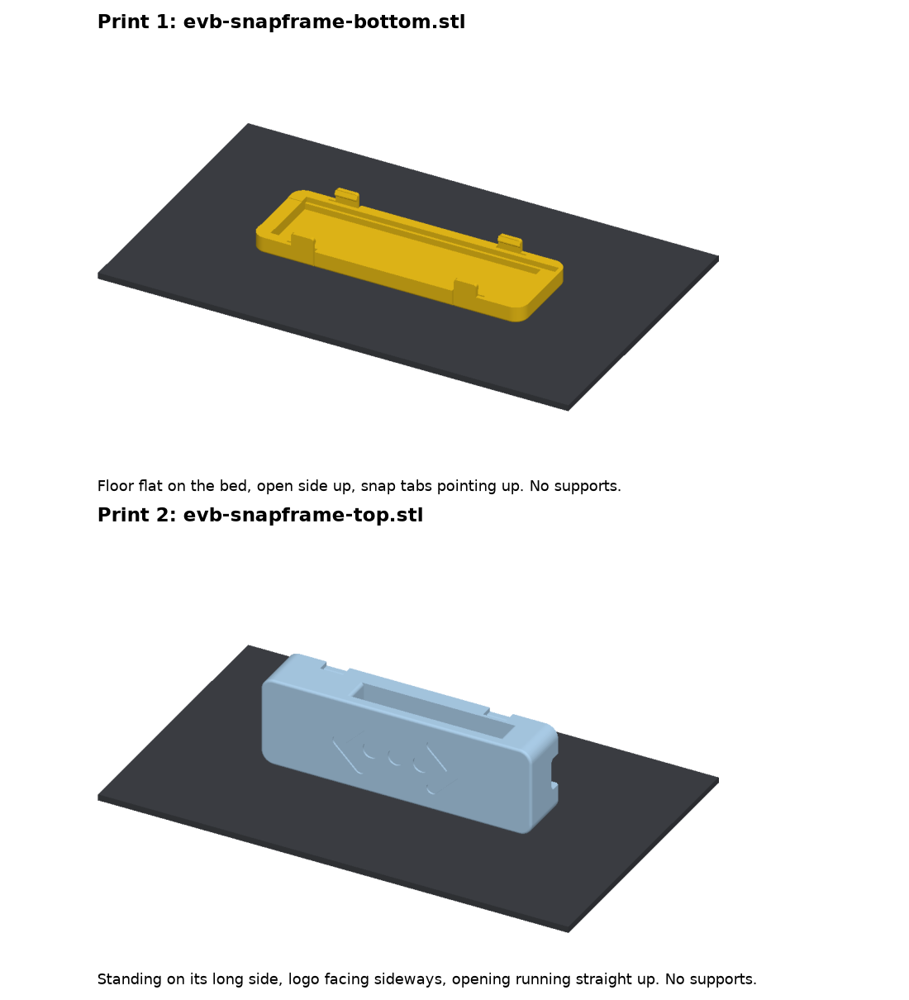
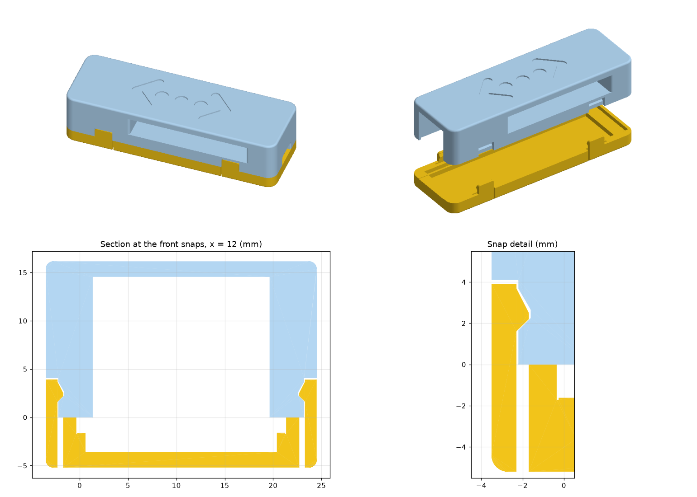

# Picoplug Enclosure

A two-piece printed case for the W55RP20-EVB-Pico: a clear top and a colored bottom that snap together, no screws.

86.4 x 28.0 x 21.3 mm, about 20 g of filament.


## Printing

The files are in `enclosure/evb-snapframe/`.

| Part | Print in |
|---|---|
| `evb-snapframe-top.stl` | Clear PLA or PETG |
| `evb-snapframe-bottom.stl` | Colored PLA or PETG |

- Clear top: 100% aligned rectilinear infill, so no pattern shows through.
- Tested on a Prusa CORE One, 0.4 mm nozzle, 0.20mm BALANCED, Prusament PETG.



## Generating the case

The STL files are ready to print. To change the case, edit the constants at the top of `enclosure/evb-snapframe/evb_snapframe.py` (for a tighter or looser snap, `BARB` in 0.1 mm steps). Needs [uv](https://docs.astral.sh/uv/). From `enclosure/evb-snapframe`:

```sh
uv run evb_snapframe.py
```

To also check the fit against the board, pass WIZnet's 3D model of it, `W55RP20-EVB-Pico_V100.step` from WIZnet's documentation (not in the repo):

```sh
uv run evb_snapframe.py path/to/W55RP20-EVB-Pico_V100.step
```

The images on this page:

```sh
uv run render_snapframe.py
uv run render_bed.py
uv run render_frosted.py path/to/W55RP20-EVB-Pico_V100.step
```


