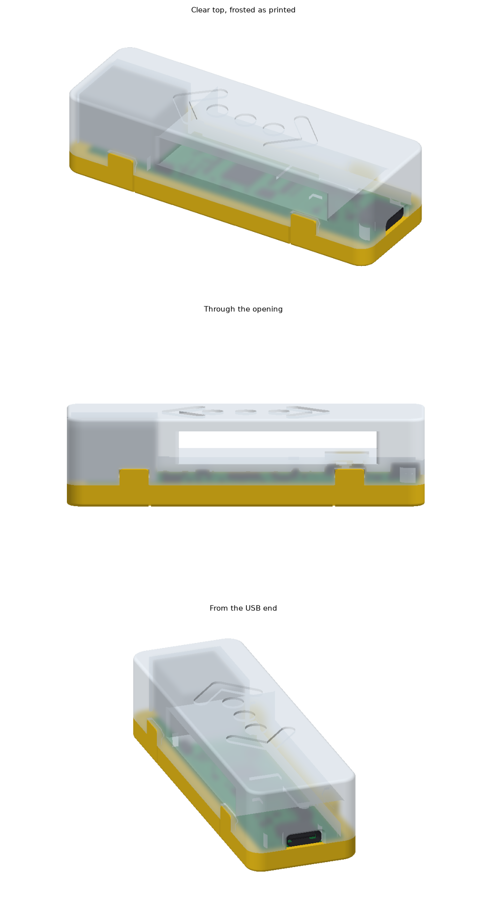

# Case

A two-piece printed case for the W55RP20-EVB-Pico: a clear top with the project logo sunk
into it and a coloured bottom, held shut by four snap arms. No screws or other hardware. An
opening through both sides between the two end blocks takes a lanyard, strap or clip.

- 86.4 x 28.0 x 21.3 mm, about 20 g of filament.
- Opening 47.7 x 7.9 mm, through both sides. The plate over it is 3 mm thick.
- Logo 37 x 14 mm, 0.6 mm deep, centred on the top. Fill it with paint pen if you want the
  dots coloured.


The files are in `enclosure/evb-snapframe/`.

| Part | Print in | Notes |
|---|---|---|
| `evb-snapframe-top.stl` | Clear PLA or PETG | BOOTSEL tongue; thin deck over the LEDs |
| `evb-snapframe-bottom.stl` | Coloured PLA or PETG | Tray and 4 snap arms |

## Printing

- Bottom: floor on the bed, no supports, default infill. Check the gaps round the arms are
  clear after printing; run a blade through if the first layer closed them.
- Top: on its long side; the STL is already rotated. The opening then runs straight up, so
  the plate and deck print as walls. The jack pocket's upper side wall still prints as an
  unsupported 22 x 14.5 mm ceiling. Paint supports on that ceiling only (PrusaSlicer:
  Supports set to For support enforcers only, then Paint-on supports) and pull them out
  through the open face. Without them it comes out rough; trim any droop at the jack mouth,
  where the clearance is only 0.25 mm.
- Clear top: 100% aligned rectilinear infill, so no infill pattern shows through.
- Tested on a Prusa CORE One, HF 0.4 nozzle, 0.20mm BALANCED.
- Prusament PETG: satin sheet wiped with IPA, no glue, chamber vent open, support top
  contact Z distance about 0.25 mm so the painted supports release. About 17 min for the
  bottom and 34 min for the top at default infill.
- Print both halves from the same version; old and new halves may not fit each other.


## Assembly

1. Drop the board into the bottom, jack end first.
2. Press the top straight down until all four arms click.
3. BOOTSEL: press the dip in the deck with a pen tip or fingernail, in through the side of
   the opening. BOOTSEL is the button nearer the USB end; the other is RUN.
4. To open: slip a small flat screwdriver into the slit at an arm's tip and ease it outward.

## Design

**Snaps.** Each snap is a 9 mm arm in the bottom's side wall, 1.2 mm thick, bending
sideways, with layers running along it. The arms are short and stiff since the case is
meant to stay shut: root strain is about 1.1%, fine in PLA for a few openings. A 45 degree
barb hooks 0.5 mm into a notch in the top; closed, the arms are relaxed. If they are too
tight or too loose, change `BARB` in 0.1 mm steps; for a softer snap, lengthen the arms in
`ARMS`.

The arms' ends are the only thing lining the halves up along the length, with 0.2 mm at
each end (`END_GAP`). The arm tops are rounded 0.8 mm (`TAB_ROUND`) so they can't jam in
the slightly round printed corners of the top's openings. If a top still sits off-centre,
`SLOT_SHIFT` moves its openings along the length.

**BOOTSEL and LEDs.** A tongue in the deck, 4 mm wide and 1.2 mm thick with 0.6 mm slits
round it, carries a nub 0.2 mm above the button. Over each LED the deck is thinned from
below to 0.8 mm so the LEDs show through clear filament.

**Board locating.** The jack pocket's back wall sits 0.1 mm behind the RJ45, from 3.6 mm
above the board up, clear of the parts behind the jack. A drop or a cable pushed into the
jack loads the jack against the top's front block, not the board against the lip under the
USB-C port. The USB-C mouth sits 1 mm inside the face, so that lip is 1.3 mm thick. The
board pocket leaves 0.35 mm a side and 0.3 mm at the USB end (`BOARD_FIT`, `BOARD_END`),
since PETG prints a little fat. The USB-C receptacle is flush with the board's top face, so
the bottom has no notch for it.

Earlier versions had a 0.5 mm lip, which cracked, and 1.7 mm pins in the board's holes,
which sheared off in a drop.

## Generating the case

The STL files in the repo are ready to print. To change the case, edit the constants at the
top of `enclosure/evb-snapframe/evb_snapframe.py` and generate the files again.

Needs [uv](https://docs.astral.sh/uv/). It installs Python 3.12 and CadQuery, matplotlib,
numpy and usd-core from `enclosure/pyproject.toml` and `uv.lock` on first run.

From `enclosure/evb-snapframe`:

```
uv run evb_snapframe.py
```

This writes `evb-snapframe-top.stl`, `evb-snapframe-bottom.stl` and the matching `.step`
files (the STEP files stay in case coordinates). A good build prints
`top/bottom overlap 0.0 mm3`.

WIZnet's 3D model of the board is not in the repo. Download `W55RP20-EVB-Pico_V100.step`
from WIZnet's documentation for the W55RP20-EVB-Pico and pass its path:

```
uv run evb_snapframe.py path/to/W55RP20-EVB-Pico_V100.step
```

This also checks the case against the board and should print `board overlap check: clear`.
It writes two coloured previews with the board inside, `evb-snapframe-assembly.usdz` and
`evb-snapframe-exploded.usdz`, which open on an iPhone or iPad. They contain WIZnet's
model, so they are not committed. `assembly.py` loads the board model and writes them.

The images on this page, after generating the case:

```
uv run render_snapframe.py                                  # docs/img/evb_snapframe_sheet.png
uv run render_bed.py                                        # docs/img/evb_snapframe_bed.png
uv run render_frosted.py path/to/W55RP20-EVB-Pico_V100.step # docs/img/evb_snapframe_frosted.png
```

`render_frosted.py` draws the case with the board inside and the clear top frosted, the
way clear filament prints. An approximation.


