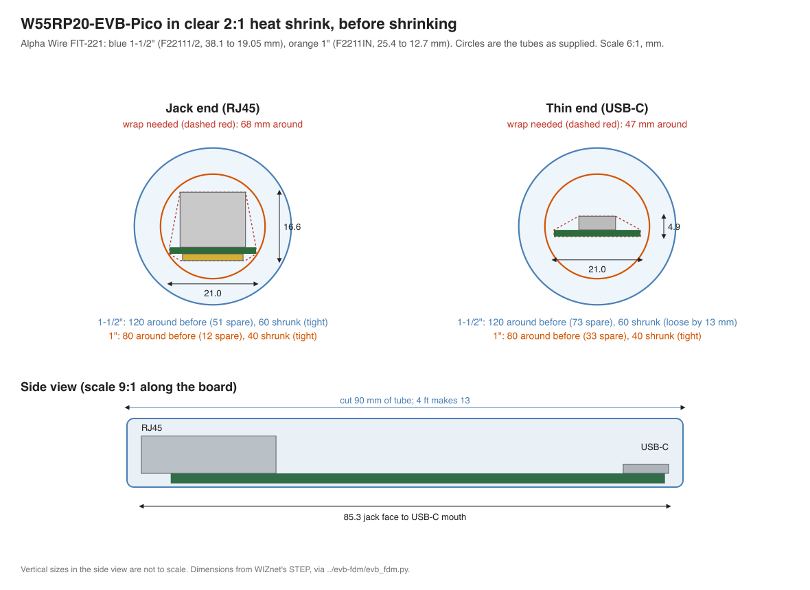

# EVB-Pico in heat shrink

The no-printer option: a length of clear 2:1 heat shrink over the W55RP20-EVB-Pico, open at
both ends for the RJ45 and USB-C.

| | Needs | 1" (Alpha F2211IN CL105) | 1-1/2" (Alpha F22111/2 CL015) |
|---|---|---|---|
| Jack end | 68 mm around | 80 before (12 spare), 40 shrunk: tight | 120 before, 60 shrunk: tight |
| Thin end | 47 mm around | 40 shrunk: tight | 60 shrunk: 13 mm loose |

- Cheapest 1" on DigiKey: Sumitomo A2 1 CLEAR 4FT (2786-A21CLEAR4FT-ND), $5.73 for 4 ft.
  Same 2:1 clear polyolefin, 0.89 mm wall, shrinks to the same 12.7 mm, and starts a bit
  bigger (26.6 mm, 84 mm around), so it slides over the jack more easily. Alpha's
  F2211IN CL105 is $12.77 there.
- 1" is the better fit: it grips the whole board. It's a snug slide over the jack, so start
  the tube square on the jack's corners.
- 1-1/2" slides on easily but stays baggy along the thin end.
- Cut 90 mm per board (85.3 mm jack face to USB-C mouth, plus a little for length shrink);
  a 4 ft stick does 13.
- Heat gun on low, keep it moving, start at the jack end.

`fit_svg.py` draws the sheet (plain Python, no dependencies; dimensions from
`../evb-fdm/evb_fdm.py`). Rasterize with
`rsvg-convert -o ../../docs/img/evb_shrink_fit.png evb_shrink_fit.svg`.
