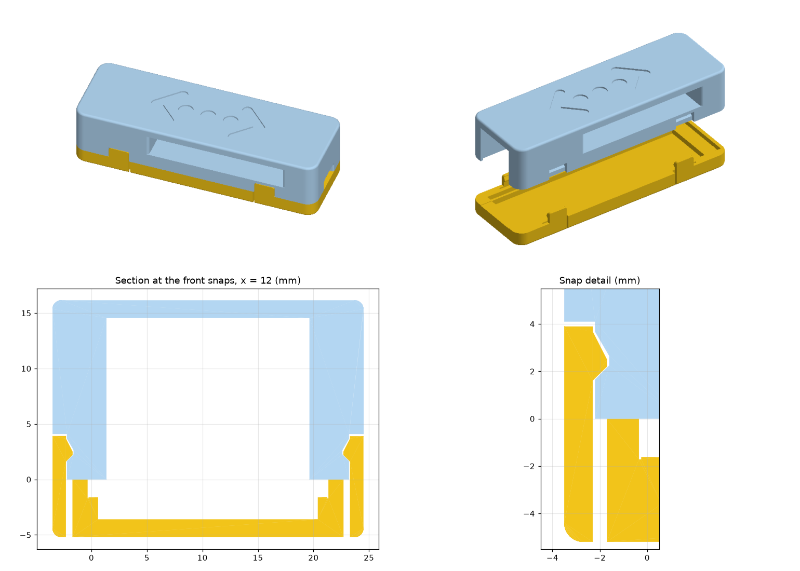

# EVB-Pico all-printed snap frame

A two-piece printed case for the W55RP20-EVB-Pico: a clear top with the project logo sunk
into it and a coloured bottom, held shut by four snap arms. No screws or other hardware. An
opening through both sides between the two end blocks takes a lanyard, strap or clip.

- 86.4 x 28.0 x 21.3 mm.
- Opening 47.7 x 7.9 mm, through both sides, for a cable, strap or clip. The plate over it
  is 3 mm thick.
- Logo 37 x 14 mm, 0.6 mm deep, centred on the top. Fill it with paint pen if you want the
  dots coloured.
- Overlap check against WIZnet's STEP is clear; the halves don't overlap each other.

## Parts

| Part | Make | Notes |
|---|---|---|
| `evb-snapframe-top.stl` | Print, clear PLA or PETG | BOOTSEL tongue; thin deck over the LEDs |
| `evb-snapframe-bottom.stl` | Print, yellow PLA or PETG | Tray and 4 snap arms |

## Snaps

Each snap is a 9 mm arm in the bottom's side wall, 1.2 mm thick, bending sideways. The case
is meant to stay shut, so the arms are short and stiff: root strain is about 1.1%, fine in
PLA for a few openings. Layers run along the arm. The arms stand on the bed, free of the
floor, with 0.6 mm gaps round them. A 45 degree barb hooks 0.5 mm into a matching notch in
the top. Closed, the arms are relaxed: the hook holds the case shut, not spring tension.

Printed: the snaps hold firmly. To open, slip a small flat screwdriver into the slit at an arm's tip
and ease it outward. If they are too tight or too loose, change `BARB` in
`evb_snapframe.py` in 0.1 mm steps. For a softer snap, lengthen the arms in `ARMS`.

The arms' ends are the only thing lining the halves up along the length. The openings in the
top leave 0.2 mm at each end of an arm (`END_GAP`). The top prints on its side, so the
openings' inside corners come out slightly round; the arm tops are rounded 0.8 mm at both
ends (`TAB_ROUND`) so square corners can't jam there and hold the top off-centre. If a top
still sits off-centre, `SLOT_SHIFT` moves its openings along the length.

## BOOTSEL and LEDs

The two tact switches sit under the deck, inside the opening. BOOTSEL is the one nearer
the USB end (x 65.5); the other is RUN. A tongue in the
deck, 4 mm wide and 1.2 mm thick with 0.6 mm slits round it, carries a nub 0.2 mm above
the button. Press the dip in the deck with a pen tip or fingernail, in through the side of
the opening. The tongue runs along the layers; root strain is about 1.3%.

Over each LED window the deck is thinned from below to 0.8 mm, so the LEDs show better
through clear filament. The plate over the opening stays 3 mm.

The USB-C receptacle sits flush with the board's top face, so the bottom has no notch for
it. WIZnet's STEP shows it 0.99 mm lower; the overlap check still comes out clear.

## Board locating

The jack pocket's back wall sits 0.1 mm behind the RJ45, from 3.6 mm above the board
up, so it clears the resistors and parts on the board behind the jack. A drop on the USB end, or a cable
pushed into the jack, loads the jack against the top's solid front block instead of the
board's end against the lip under the USB-C port. The case extends 1 mm past the
USB-C mouth, so the mouth sits 1 mm inside the face and that lip is 1.3 mm thick (it was
0.5 and cracked). The board pocket leaves 0.35 mm a side and 0.3 mm at the USB end
(`BOARD_FIT`, `BOARD_END`), since PETG prints a little fat; the jack stop keeps the board
off the lip once the top is on. Under the board's rear end the
bottom is solid.

An earlier version used 1.7 mm pins in the board's holes; they sheared off in a drop and are
gone.

## Printing

- Bottom: floor on the bed, no supports. Check the gaps round the arms are clear after
  printing; run a blade through if the first layer closed them.
- Top: on its long side. The STL is already rotated. The opening then runs straight up, so
  the plate and deck are walls, with no long bridges over the opening. The jack pocket
  still has one: its upper side wall prints as an unsupported 22 x 14.5 mm ceiling, so it
  comes out rough. That face is inside the case, with 1.2 mm clearance to the jack. At the
  jack mouth the clearance is only 0.25 mm, so trim any droop there with a blade. For a
  cleaner result, paint supports on that ceiling only (PrusaSlicer: Supports set to For
  support enforcers only, then Paint-on supports) and pull them out through the open face.
- 0.2 mm layers (Prusa CORE One HF0.4, 0.20mm BALANCED). Bottom: default infill. Clear top:
  100% aligned rectilinear, so no infill pattern shows through.
- PETG (Prusament, the current choice): satin sheet, wiped with IPA, no glue; chamber vent
  open; support top contact Z distance about 0.25 mm so the painted supports release.
- About 17 min for the bottom and 34 min for the top in PETG at default infill (longer at
  100%); about 20 g a case.

## Files

- `evb_snapframe.py`: CadQuery model; the board's dimensions and every tunable are at the top.
  `uv run evb_snapframe.py` writes the STL and STEP files. Given WIZnet's board model
  (`W55RP20-EVB-Pico_V100.step`, from WIZnet's documentation for the board, not included
  here) as an argument, it also checks the case against the board and writes the coloured
  `evb-snapframe-assembly.usdz` and `evb-snapframe-exploded.usdz`. The STEP files stay in
  case coordinates.
- `assembly.py`: loads WIZnet's board model and writes the USDZ previews.
- `render_snapframe.py`: writes `docs/img/evb_snapframe_sheet.png`.
- `render_bed.py`: writes `docs/img/evb_snapframe_bed.png`, the parts as they sit on the print bed.
- `render_frosted.py <board.step>`: writes `docs/img/evb_snapframe_frosted.png`, the case with the board inside
  and the clear top drawn frosted, the way clear filament prints. Each clear wall the eye
  passes through lets 40% of what's behind it through, blurred. An approximation.
